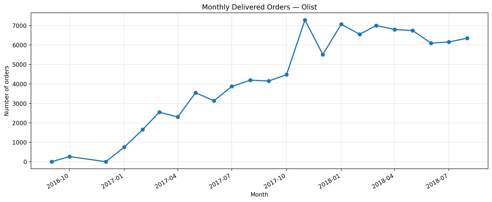
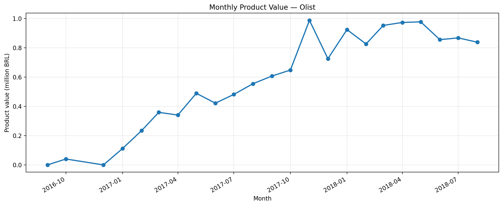
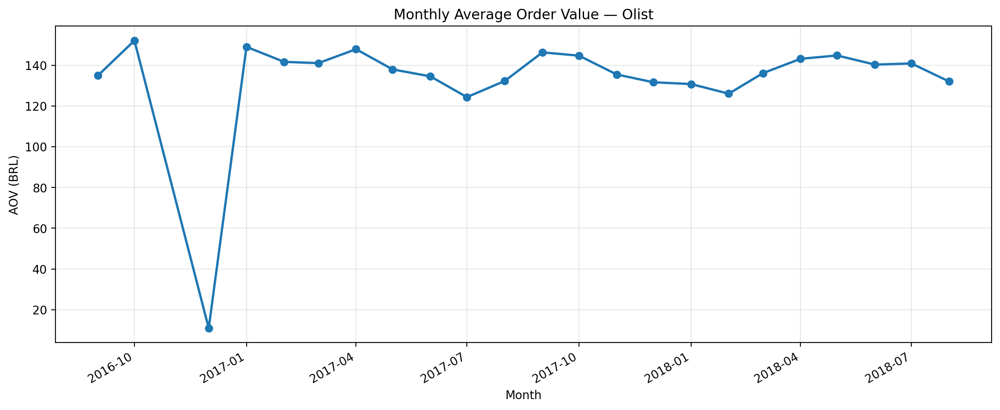
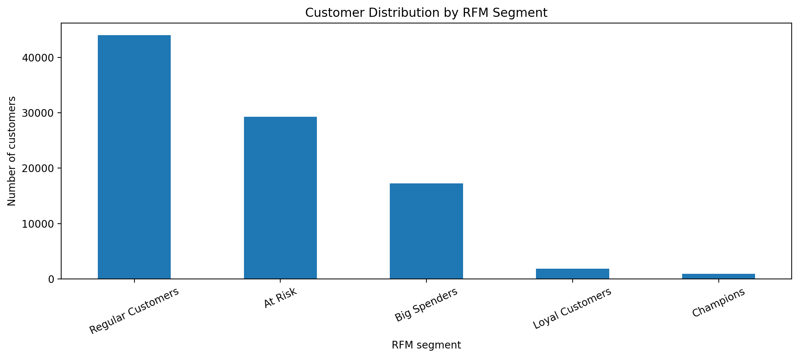
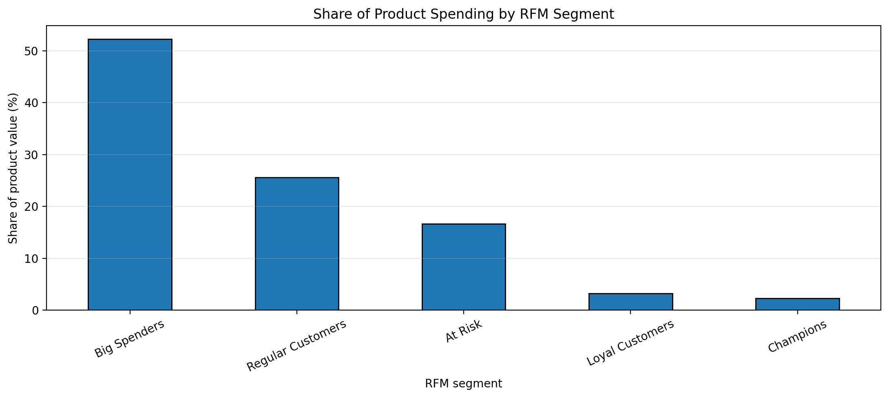

# Анализ продаж и клиентского поведения маркетплейса Olist

## О проекте

Аналитический пет-проект на основе реальных обезличенных
данных бразильского маркетплейса Olist.

Цель проекта — исследовать динамику продаж, поведение
покупателей и определить ключевые клиентские сегменты
для разработки бизнес-рекомендаций.

## Используемые технологии

- PostgreSQL — хранение данных и SQL-запросы
- Python — обработка и анализ данных
- Pandas, NumPy — расчёт метрик и сегментация
- Matplotlib — визуализация данных
- SQLAlchemy — подключение к PostgreSQL
- Jupyter Notebook — исследовательский анализ

## Датасет

Источник: Brazilian E-Commerce Public Dataset by Olist

https://www.kaggle.com/datasets/olistbr/brazilian-ecommerce

Датасет содержит около 100 тысяч заказов за 2016–2018 годы.

Для анализа использованы таблицы:
- customers — информация о покупателях
- orders — информация о заказах
- order_items — товары в заказах и их стоимость
- payments — информация о платежах

## Бизнес-задачи

1. Исследовать динамику количества заказов и стоимости
   проданных товаров.
2. Рассчитать средний чек (AOV) и его изменение.
3. Определить долю покупателей с повторными заказами.
4. Провести RFM-сегментацию покупателей.
5. Сформулировать рекомендации на основе результатов.

## 1. Анализ продаж

### Основные результаты

- Доставленных заказов: 96 478.
- Средний чек доставленного заказа: 137,04 BRL.
- Рост количества заказов в ноябре 2017 года
  относительно октября: 62,77%.
- Рост стоимости проданных товаров за тот же
  период: 52,37%.

### Выводы

В ноябре 2017 года количество заказов выросло быстрее,
чем стоимость проданных товаров. При этом средний чек
снизился с 144,76 до 135,51 BRL.

Возможные объяснения — сезонные распродажи или
изменение структуры покупок. Для подтверждения
этих гипотез необходим дополнительный анализ.

### Визуализация продаж

**Количество доставленных заказов по месяцам**

**Стоимость проданных товаров по месяцам**

**Средний чек по месяцам**

## 2. Анализ покупателей

### Основные показатели

- Уникальных покупателей: 93 358.
- Покупателей с двумя и более доставленными
  заказами: 2 801.
- Доля повторных покупателей (RPR): 3,00%.

### Выводы

Только около 3% покупателей совершили более одного
доставленного заказа за период наблюдения.

Этот показатель требует дополнительного исследования
с учётом времени с первой покупки и особенностей
товарных категорий.

## 3. RFM-анализ

Для сегментации использованы три показателя:

- Recency — количество дней с последней покупки.
- Frequency — количество доставленных заказов.
- Monetary — суммарная стоимость купленных товаров.

Дата анализа: 1 сентября 2018 года.

Покупатели распределены на пять сегментов:

| Сегмент | Количество покупателей |
|---|---:|
| Regular Customers | 44 010 |
| At Risk | 29 293 |
| Big Spenders | 17 254 |
| Loyal Customers | 1 868 |
| Champions | 933 |

### Основные результаты

- Сегмент Big Spenders включает 17 254 покупателя.
- На Big Spenders приходится около 52,4% стоимости
  товаров в проанализированных заказах.
- Сегмент Champions насчитывает 933 покупателя.
- Большинство покупателей совершили только один заказ.

### Выводы

Значительная доля стоимости проданных товаров
приходится на покупателей с высокими разовыми
расходами.

При этом повторные покупки встречаются относительно
редко, что создаёт основания для изучения факторов,
влияющих на повторные заказы.

### Визуализация клиентских сегментов

**Распределение покупателей по сегментам**

**Доля стоимости товаров по RFM-сегментам**

## 4. Бизнес-рекомендации

1. Протестировать персонализированные предложения
   для покупателей с высокими расходами, чтобы
   стимулировать повторные покупки.

2. Исследовать причины длительных перерывов между
   покупками у клиентов сегмента At Risk.

3. Изучить категории товаров, которые чаще
   приобретают повторные покупатели.

4. Провести когортный анализ для более точной
   оценки удержания клиентов.

## 5. Ограничения исследования

- Анализируется стоимость товаров без доставки,
  а не прибыль маркетплейса.
- RFM-анализ учитывает доставленные заказы,
  оформленные до 1 сентября 2018 года.
- Границы RFM-сегментов выбраны для учебного анализа.
- Давность последней покупки не доказывает отток.
- Данные не позволяют установить причины
  изменения продаж без дополнительных исследований.

## Проверки и интерпретация

- Для AOV используется сумма `order_items.price`, разделённая на количество уникальных доставленных заказов, имеющих записи о товарах.
- MoM рассчитан за январь 2017 — август 2018. Январь служит базовым месяцем, а данные 2016 года исключены из расчёта MoM из-за неполных периодов.
- RFM и Repeat Purchase Rate в финальном Notebook рассчитаны на едином срезе заказов, оформленных до 1 сентября 2018 года.
- Big Spenders определены на основе Monetary, поэтому их высокая доля покупок частично предопределена методикой.

## Структура проекта

- notebooks/02_final_analysis.ipynb — основной Notebook, запускаемый сверху вниз
- sql/create_tables.sql — создание таблиц PostgreSQL
- sql/sales_analysis.sql — SQL-метрики продаж
- sql/customer_rfm.sql — клиентская аналитика и RFM
- reports/figures/ — графики
- requirements.txt — зависимости Python

## Как запустить проект

1. Скачать датасет Olist с Kaggle.
2. Создать базу данных PostgreSQL.
3. В **пустой** базе `ecommerce_analytics` выполнить `sql/create_tables.sql` (не повторять, если таблицы уже есть).
4. Импортировать CSV через pgAdmin в таблицы `customers`, `orders`, `order_items`, `payments` с включённым заголовком, разделителем `,` и кодировкой UTF-8. Соответствие: `olist_customers_dataset.csv` → `customers`, `olist_orders_dataset.csv` → `orders`, `olist_order_items_dataset.csv` → `order_items`, `olist_order_payments_dataset.csv` → `payments`.
5. Установить библиотеки:

   pip install -r requirements.txt

6. Открыть `notebooks/02_final_analysis.ipynb` в VS Code.
7. Убедиться, что сервер PostgreSQL запущен на `localhost:5432`, пользователь — `postgres`; пароль вводится при запуске Notebook.
8. Выполнить ячейки Notebook по порядку (Restart → Run All). Графики сохранятся в `reports/figures/`.
